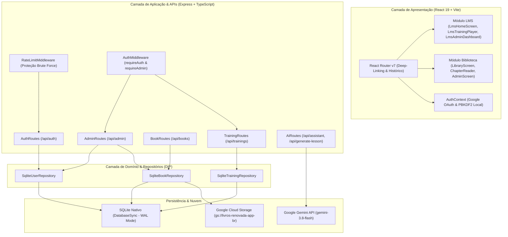

# Catálogo de Componentes, Arquitetura e Funcionalidades

> **Aplicação**: Lumi — Plataforma Integrada de Treinamentos (LMS) e Biblioteca Digital Editorial  
> **Repositório**: `lumi-renovada-app-br`  
> **Padrões**: SOLID, Clean Architecture, React 19, Tailwind CSS v4, Express TypeScript, SQLite WAL  

---

## 1. Visão Geral da Arquitetura

A plataforma Lumi combina dois grandes ecossistemas em uma experiência única, fluida e reativa:
1. **LMS (Learning Management System / Treinamentos Renovada)**: Gestão de cursos em vídeo, controle de presença e auditoria em videoaulas (YouTube/Google Drive), gestão de dependências hierárquicas entre categorias e cursos, emissão/revogação de certificados com hash de autenticidade, e promoção de usuários a administradores.
2. **Biblioteca Digital & Leitor Editorial**: Acervo de livros em PDF com conversão inteligente em capítulos via Gemini AI (`gemini-3.8-flash`), leitor ergonômico (temas Claro, Escuro e Sépia Pergaminho), busca instantânea (`Ctrl+K`), modo bilíngue e mentor pastoral com geração de lições de célula de 90 minutos.

---

## 2. Catálogo de Componentes do Frontend

### 2.1. Núcleo da Aplicação & Navegação Global

#### `src/App.tsx`
- **Responsabilidade (SRP)**: Ponto de entrada da navegação reativa e montagem de layout. Integra o roteamento declarativo via `react-router-dom` v7 com URLs profundas (`/`, `/treinamentos/:id`, `/favoritos`, `/certificados`, `/biblioteca`, `/leitor/:id`, `/admin`), sincronização com o histórico do navegador e disparo de modais operacionais.
- **Funcionalidades**:
  - Deep-linking para cursos específicos e abas administrativas (`/admin?tab=students`).
  - Sincronização de tema (`light`, `dark`, `sepia`).
  - Renderização condicional do cabeçalho global e rodapés móveis.

#### `src/context/AuthContext.tsx`
- **Responsabilidade**: Gerenciamento centralizado do estado de autenticação, perfil do usuário logado, permissões (`role: 'admin' | 'user'`) e histórico de capítulos lidos.
- **Funcionalidades**:
  - Login e registro direto por e-mail/senha com proteção contra timing attacks.
  - Login federado com Google Sign-In via ID Token JWT.
  - Sincronização automática de progresso e persistência de sessão via cookie HttpOnly.

#### `src/components/Navbar.tsx` & `src/components/Sidebar.tsx`
- **Responsabilidade**: Barra de navegação superior e menu lateral responsivo para acesso à estante, leitor, biblioteca e alternância de temas.

#### `src/components/LoginModal.tsx`
- **Responsabilidade**: Interface de autenticação híbrida.
- **Funcionalidades**:
  - Abas "Entrar" e "Criar Conta".
  - Botão oficial do Google Sign-In (OAuth 2.0).
  - Formulário de e-mail e senha com validação inline e feedback de erro.

---

### 2.2. Módulo LMS (Treinamentos, Cursos e Aulas)

#### `src/components/lms/LmsHomeScreen.tsx`
- **Responsabilidade**: Tela inicial do LMS para alunos e líderes.
- **Funcionalidades**:
  - Banner hero dinâmico com curso em destaque.
  - Filtro por categorias com indicação de pré-requisitos não atendidos.
  - Seção de cursos obrigatórios com avisos de pendência.
  - Cards de cursos com carga horária, progresso do aluno e status de bloqueio por pré-requisito.

#### `src/components/lms/LmsNavbar.tsx`
- **Responsabilidade**: Cabeçalho de navegação do ambiente de treinamentos.
- **Funcionalidades**:
  - Indicador de "Minhas Pendências" com badge numérica em tempo real.
  - Atalhos rápidos para "Todos os Treinamentos", "Salvos", "Meus Certificados" e "Painel Admin" (visível apenas para admins).

#### `src/components/lms/LmsTrainingPlayer.tsx`
- **Responsabilidade**: Player interativo de videoaulas com **auditoria rígida de visualização**.
- **Funcionalidades**:
  - Suporte a vídeos do **YouTube** (Player Iframe API) e **Google Drive** (Preview Iframe).
  - **Auditoria de Conclusão**: O botão "Concluir Aula" permanece bloqueado até que o aluno assista ao tempo mínimo estipulado (ex: 80% do vídeo) ou complete o tempo mínimo de leitura em materiais textuais.
  - Transição automática para a próxima aula da trilha.
  - Emissão instantânea de certificado ao concluir a última aula do curso.

#### `src/components/lms/LmsCertificatesScreen.tsx`
- **Responsabilidade**: Galeria pessoal de certificados do aluno.
- **Funcionalidades**:
  - Exibição em grade de todos os certificados emitidos para o usuário autenticado.
  - Visualização do certificado diagramado em alta resolução com selo de autenticidade e código verificável (ex: `LUMI-2026-ABCD1234`).
  - Download em PDF e imagem PNG.

#### `src/components/lms/LmsBookmarksScreen.tsx`
- **Responsabilidade**: Gestão de cursos salvos/favoritados pelo aluno para acesso rápido.

#### `src/components/lms/LmsUserProfileScreen.tsx`
- **Responsabilidade**: Painel do Aluno / Perfil do Usuário com visão 360° de métricas de aprendizado, cursos matriculados, certificados e gestão cadastral.
- **Funcionalidades**:
  - **Aba "Métricas & Aprendizado"**:
    - Indicadores analíticos do aluno: cursos matriculados, formações concluídas, aulas assistidas, horas de estudo acumuladas, certificados conquistados e taxa média de progresso.
    - Seção "Continuar de Onde Parou" com cards interativos e botão de atalho para o player de aula.
    - Seção de certificados recentes conquistados com hash de validação.
  - **Aba "Cursos Matriculados"**:
    - Listagem de todas as formações que o aluno iniciou ou concluiu.
    - Filtros por status: "Todos", "Em Andamento" e "Concluídos", além de campo de busca instantânea.
    - Barra de progresso visual de aulas e atalho rápido para continuar ou rever o curso.
  - **Aba "Meus Certificados"**:
    - Grade de certificados emitidos com data, carga horária e código de autenticidade (com cópia em 1 clique).
    - Botão "Visualizar & Baixar (.pdf)" acionando o visualizador de alta resolução e download.
  - **Aba "Meus Dados & Segurança"**:
    - Atualização cadastral de nome completo e URL da foto de perfil.
    - Alteração de senha com exigência e validação da senha atual (se cadastrada) e confirmação de nova senha (mínimo 6 caracteres).

---

### 2.3. Painel Administrativo LMS Modularizado (`src/components/lms/admin/`)

O painel administrativo do LMS adota o **Princípio da Responsabilidade Única (SRP)**, dividindo cada seção em abas autônomas e modais reutilizáveis:

#### `src/components/lms/LmsAdminDashboard.tsx`
- **Responsabilidade**: Orquestrador principal do painel administrativo, gerenciando carregamento de dados, abas ativas, notificações tipo toast e injeção de dependências para as abas filhas.

#### `src/components/lms/admin/tabs/MetricsTab.tsx`
- **Responsabilidade**: Visão analítica e KPIs gerais do LMS.
- **Métricas Apresentadas**:
  - Total de Cursos publicados vs rascunhos.
  - Total de Aulas cadastradas no acervo.
  - **Alunos Cadastrados**: Total de membros registrados no sistema e total de matrículas ativas.
  - Total de Formações Concluídas e taxa média de conclusão.
  - Total de Certificados emitidos.
  - Gráfico de desempenho por Categoria/Ministério.

#### `src/components/lms/admin/tabs/StudentsTab.tsx`
- **Responsabilidade**: Gestão centralizada de alunos, permissões, credenciais e matrículas.
- **Funcionalidades**:
  - **Sub-aba "Alunos & Usuários Cadastrados"**:
    - Lista todos os membros cadastrados na plataforma (com foto, nome, e-mail e data de cadastro).
    - **Promoção a Administrador**: Permite promover qualquer aluno a administrador com modal de confirmação e feedback imediato.
    - **Revogação de Administrador**: Permite revogar permissões de admin de forma segura (com trava que impede o administrador atual de revogar seu próprio acesso).
    - **Edição de Cadastro**: Modal dedicado para alterar nome, e-mail e papel do usuário (`admin` ou `user`).
    - **Redefinição de Senha**: Permite ao administrador alterar a senha de qualquer usuário diretamente pelo painel (com opção de alternar visibilidade de senha).
    - **Exclusão de Usuário**: Permite excluir permanentemente cadastros indevidos ou duplicados, limpando sessões, progresso de leitura, matrículas, auditorias e certificados associados.
    - Bloqueio e desbloqueio de contas.
    - Exibição de engajamento individual: total de cursos matriculados, concluídos e certificados obtidos.
  - **Sub-aba "Matrículas & Progresso em Cursos"**:
    - Tabela de progresso dos alunos nas videoaulas.
    - Conclusão manual de curso com emissão de certificado em caso de necessidades operacionais.
    - Reinício de progresso do aluno quando necessário.
    - Filtro por curso específico, status e busca textual.

#### `src/components/lms/admin/tabs/CoursesTab.tsx`
- **Responsabilidade**: Gestão do catálogo de cursos.
- **Funcionalidades**:
  - Criação, edição e exclusão de treinamentos.
  - Definição de **Pré-requisito dentro da Categoria** (ex: "Para cursar Liderança Avançada, é obrigatório concluir Liderança Básica").
  - Associação de Categoria/Ministério.
  - Definição de curso obrigatório (`isRequired`) e destaque (`isFeatured`).
  - Carga horária e associação opcional a livro da biblioteca digital.

#### `src/components/lms/admin/tabs/MinistriesTab.tsx`
- **Responsabilidade**: Gestão de Categorias e Ministérios com **Hierarquia de Dependência**.
- **Funcionalidades**:
  - Cadastro, edição e exclusão de categorias ministeriais (ex: Diaconia, Louvor, Liderança, Infantil).
  - Definição de **Categoria Pré-requisito** (ex: "Para cursar a categoria Diaconia, o aluno deve ter concluído previamente a categoria Liderança").
  - Prevenção de dependências circulares.

#### `src/components/lms/admin/tabs/CertificatesTab.tsx`
- **Responsabilidade**: Auditoria e controle de certificados emitidos.
- **Funcionalidades**:
  - Listagem de todos os certificados emitidos na plataforma com código de validação, aluno, curso e data.
  - **Revogação de Certificado**: Permite cancelar certificados emitidos equivocadamente, com opção de resetar ou manter o progresso do aluno.
  - **Emissão Manual de Certificado**: Permite emitir um novo certificado para um aluno em caso de ajustes administrativos.
  - Pré-visualização do certificado em modal com canvas e código QR.

#### `src/components/lms/admin/tabs/LessonsTab.tsx`
- **Responsabilidade**: Gestão de módulos e videoaulas de cada curso (links do YouTube/Drive, materiais de apoio, ordem das aulas e tempo mínimo de exibição).

#### `src/components/lms/admin/tabs/LibraryTab.tsx`
- **Responsabilidade**: Visão integrada do acervo de livros da biblioteca digital dentro do painel administrativo.

---

### 2.4. Módulo Biblioteca Digital & Leitor Editorial

#### `src/components/librarial/LibraryScreen.tsx`
- **Responsabilidade**: Tela inicial moderna da biblioteca (interface Librarial).
- **Funcionalidades**:
  - Carrossel de destaques editoriais.
  - Pílulas de filtro por categoria literária.
  - Lista horizontal de títulos mais lidos e recomendados.
  - Grade de livros com capa, autor e progresso de leitura individual.

#### `src/components/ChapterReader.tsx`
- **Responsabilidade**: Leitor de alto conforto visual e estudo teológico aprofundado.
- **Funcionalidades**:
  - **Temas de Leitura**: Sépia Pergaminho (foco editorial), Modo Escuro e Modo Claro.
  - **Controle Tipográfico**: Ajuste dinâmico de fonte (`A-`, `A`, `A+`) e altura de linha.
  - **Sumário Navegável**: Painel lateral com lista de capítulos e indicação de leitura concluída.
  - **Modo Bilíngue**: Comparação paralela ou alternada entre o texto em português e o texto original em inglês.
  - **Assistente Pastoral IA & Gerador de Lição de Célula (90 min)**: Geração contextualizada de quebra-gelo, louvor, estudo bíblico e perguntas reflexivas com base no capítulo lido.
  - **Busca Instantânea (`Ctrl+K`)**: Indexação e localização imediata de termos em todo o livro.
  - **Exportação Multi-formato**: Download em PDF diagramado via `jsPDF` e exportação como Aplicativo Offline em Arquivo Único HTML (`.html`).

#### `src/components/UploadBookModal.tsx`
- **Responsabilidade**: Envio de novos arquivos PDF para a biblioteca e processamento automatizado por IA sem tocar o disco.

#### `src/components/ChapterEditorModal.tsx` & `src/components/BookEditorModal.tsx`
- **Responsabilidade**: Revisão editorial de capítulos, títulos, parágrafos e perguntas reflexivas.

---

## 3. Catálogo de Serviços e Rotas do Backend

### 3.1. Repositórios de Dados (SQLite Nativo WAL)

#### `src/server/repositories/trainingRepository.ts`
- **Responsabilidade**: Persistência de cursos, categorias, aulas, progresso, auditoria e certificados.
- **Métodos Principais**:
  - `getTrainings(userId, categoryId)`: Retorna cursos calculando elegibilidade com base em pré-requisitos de categoria e de curso.
  - `saveLessonWatchAudit(userId, lessonId, durationSeconds, completed)`: Registra métricas de visualização auditadas.
  - `completeLesson(userId, trainingId, lessonId)`: Conclui aula após validação dos requisitos mínimos.
  - `getAllCertificates(search, trainingId)`: Consulta certificados para auditoria.
  - `deleteCertificate(certificateId, resetProgress)`: Revoga certificado.
  - `issueCertificateManually(...)`: Emissão manual.
  - `getAdminReportSummary()`: Agrega estatísticas analíticas de treinamentos, aulas, alunos e conclusões.

#### `src/server/repositories/userRepository.ts`
- **Responsabilidade**: Gestão de identidades, sessões, senhas e papéis de usuário.
- **Métodos Principais**:
  - `listUsers()`: Retorna todos os usuários com métricas agregadas de engajamento (`enrollmentsCount`, `completedCount`, `certificatesCount`).
  - `updateUserRole(userId, 'admin' | 'user')`: Promove ou revoga permissão de administrador.
  - `updateUserProfileAndAuth(userId, { name, email, password, role })`: Atualiza dados cadastrais e senha com hash PBKDF2 seguro.
  - `deleteUser(userId)`: Remove o usuário permanentemente com limpeza em cascata em todas as tabelas relacionadas.
  - `setUserBlocked(userId, boolean)`: Bloqueia ou desbloqueia acesso.
  - `verifyEmailUser(email, password)`: Valida credenciais com PBKDF2 e comparação em tempo constante (`timingSafeEqual`).
  - `createSession(userId)` / `deleteSession(token)`: Ciclo de vida de tokens seguros de sessão.

#### `src/server/repositories/bookRepository.ts`
- **Responsabilidade**: Gestão de acervo literário, capítulos, destaques editoriais e configurações do sistema (`gemini_api_key`, `admin_api_key`).

---

### 3.2. Endpoints e Rotas da API

| Rota | Método | Proteção | Descrição |
|---|---|---|---|
| `/api/auth/register` | `POST` | Rate Limited | Registro de usuário com nome, e-mail e senha |
| `/api/auth/login` | `POST` | Rate Limited | Autenticação por e-mail e senha |
| `/api/auth/google` | `POST` | Rate Limited | Troca de credencial Google ID Token por sessão segura |
| `/api/auth/me` | `GET` | Pública/Sessão | Retorna perfil do usuário logado e progresso |
| `/api/auth/profile` | `PUT` | Autenticado | Atualiza dados cadastrais, foto e senha do próprio usuário |
| `/api/auth/logout` | `POST` | Sessão | Encerra sessão ativa e invalida cookie |
| `/api/admin/users` | `GET` | `requireAdmin` | Lista todos os usuários cadastrados e estatísticas de engajamento |
| `/api/admin/users/:id` | `PUT` | `requireAdmin` | Edita dados do usuário (nome, e-mail, senha e papel) |
| `/api/admin/users/:id` | `DELETE` | `requireAdmin` | Exclui permanentemente um usuário e seus registros vinculados |
| `/api/admin/users/:id/role` | `PUT` | `requireAdmin` | Promove ou revoga permissão de administrador |
| `/api/admin/users/:id/block` | `PUT` | `requireAdmin` | Bloqueia ou desbloqueia conta de usuário |
| `/api/trainings` | `GET` | Autenticado | Lista cursos disponíveis e valida pré-requisitos |
| `/api/trainings/my-learning` | `GET` | Autenticado | Retorna métricas de aprendizado, cursos matriculados e certificados do aluno |
| `/api/trainings/:id` | `GET` | Autenticado | Detalhes do curso, syllabus e status de conclusão |
| `/api/trainings/:id/lessons/:lessonId/complete` | `POST` | Autenticado | Conclui aula com validação de auditoria |
| `/api/trainings/admin/students` | `GET` | `requireAdmin` | Lista matrículas e progresso de alunos |
| `/api/trainings/admin/students/:userId/trainings/:trainingId/complete` | `POST` | `requireAdmin` | Conclui curso manualmente para um aluno |
| `/api/trainings/admin/students/:userId/trainings/:trainingId/progress` | `DELETE` | `requireAdmin` | Reinicia progresso de um aluno no curso |
| `/api/trainings/admin/certificates` | `GET` | `requireAdmin` | Lista certificados para auditoria |
| `/api/trainings/admin/certificates/:id` | `DELETE` | `requireAdmin` | Revoga certificado |
| `/api/trainings/admin/certificates/issue` | `POST` | `requireAdmin` | Emite certificado manualmente |
| `/api/trainings/categories` | `GET` / `POST` / `PUT` / `DELETE` | `requireAdmin` | CRUD de categorias e definição de pré-requisitos |
| `/api/books` | `GET` / `POST` / `PUT` / `DELETE` | Misto | Gestão e leitura do acervo de livros |
| `/api/assistant` | `POST` | Autenticado | Mentor de estudo interativo com Gemini AI |
| `/api/generate-lesson` | `POST` | Autenticado | Gerador de roteiro de célula de 90 min com Gemini AI |

---

## 4. Políticas de Segurança e Boas Práticas

1. **Credenciais e Segredos**:
   - Nenhuma chave de API ou segredo de serviço é commitado no repositório.
   - Variáveis sensíveis (`GEMINI_API_KEY`, `GOOGLE_CLIENT_SECRET`, `ADMIN_API_KEY`) são gerenciadas estritamente via `.env` local ou segredos de ambiente no Cloud Run e GitHub Secrets.
2. **Proteção de Dados em Repouso e em Trânsito**:
   - Senhas locais são protegidas com salt criptográfico de 16 bytes e hash PBKDF2-SHA-512 (10.000 iterações).
   - Cookies de sessão utilizam as diretivas `HttpOnly`, `SameSite=Lax` e `Secure` (em produção).
   - Rate limiting automático contra ataques de dicionário e força bruta em todas as rotas de autenticação.
3. **Integridade de Código e Tipagem**:
   - 100% de cobertura com tipos TypeScript rígidos (`npx tsc --noEmit` sem erros).
   - Suíte de testes automatizados com Vitest cobrindo fluxos de ponta a ponta.

---

## 5. Progressive Web App (PWA) & Capacidades Offline

A aplicação Lumi é um **Progressive Web App (PWA)** instalável em smartphones (Android/iOS), tablets e computadores desktop (Chrome/Edge/Safari), com suporte a execução standalone em tela cheia e tolerância a falhas de rede.

### 5.1. Componentes do Ecossistema PWA

1. **Manifesto da Aplicação (`public/manifest.webmanifest` / `manifest.json`)**:
   - Configura nome, ícones adaptativos (192x192, 512x512, maskable com safe zone de 20%), cor tema (`#0F1224`), orientação e modo de exibição `standalone`.
   - Atalhos rápidos configurados para navegação direta na Biblioteca Digital, LMS Treinamentos e Painel do Aluno.
2. **Service Worker (`public/sw.js`)**:
   - **Pre-caching de App Shell**: Armazena no cache inicial a casca da aplicação (`/`, `/index.html`, ícones e fontes essenciais).
   - **Stale-While-Revalidate**: Entrega instantaneamente scripts, folhas de estilo e imagens, revalidando em segundo plano.
   - **Network-First com Fallback Offline**: Requisições de leitura de livros (`/api/books`) e treinamentos (`/api/trainings`) tentam a rede primeiro e, caso o usuário esteja sem conexão, servem os dados salvos em cache local.
   - **Ciclo de Vida Controlado**: Escuta o evento `SKIP_WAITING` para atualização sem travamentos e reivindicação imediata de clientes (`clients.claim()`).
3. **Gerenciador de Estado PWA (`src/context/PwaContext.tsx`)**:
   - Detecta eventos `beforeinstallprompt`, status de conexão (`online`/`offline`), modo standalone (`display-mode: standalone`) e disponibilidade de nova versão do Service Worker.
4. **Interface e Banners de Instalação (`src/components/pwa/PwaInstallBanner.tsx`)**:
   - Notificação discreta de modo offline quando a conexão cai.
   - Aviso com botão de atualização em um clique quando uma nova versão da plataforma é disponibilizada.
   - Banner de instalação para dispositivos Android e computadores, além de guia passo a passo para usuários de Safari no iOS.
