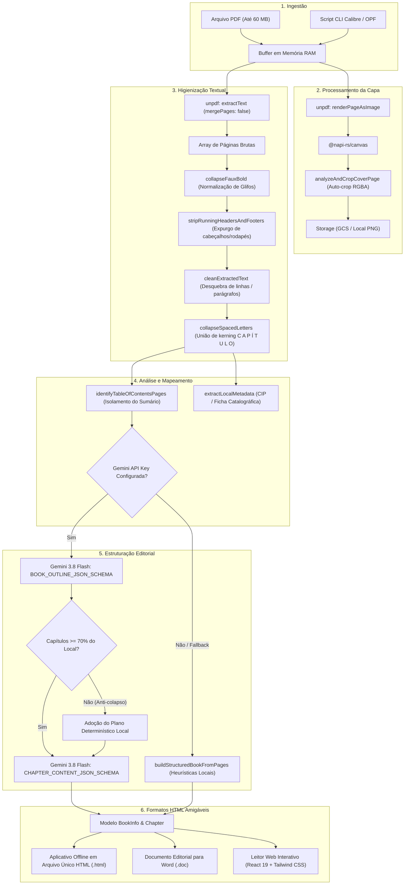

# Documentação Técnica: Conversão de Livros em PDF / E-BOOK para Formato HTML Amigável

> **Projeto**: Lumi — Biblioteca Digital & Leitor Editorial (`lumi-renovada-app-br`)  
> **Módulo**: Conversor e Estruturador Editorial de Livros  
> **Status**: Produção / Ativo  

---

## 1. Visão Geral

Este documento descreve detalhadamente o ecossistema e o pipeline de **conversão de livros em PDF ou E-BOOK para o formato HTML amigável e aplicativo autônomo offline** implementado no projeto Lumi.

O sistema resolve um dos maiores desafios de bibliotecas digitais modernas: livros em formato PDF (especialmente digitalizações antigas com OCR, livros diagramados em colunas ou edições de alta complexidade gráfica) são rígidos e de difícil leitura em telas pequenas. O conversor do Lumi transforma esses arquivos em **livros fluidos, limpos, organizados por capítulos contínuos, com tipografia responsiva e suporte a leitura offline em arquivo único HTML**.

---

## 2. Diagrama de Fluxo do Pipeline de Conversão



---

## 3. Etapas do Processamento em Detalhes

### 3.1. Ingestão Segura e Fila de Conversão

- **Upload via Web**: Rota `POST /api/books/upload` utilizando `multer.memoryStorage()` com limite de 60 MB. O arquivo não é gravado em disco temporário para evitar contenção de I/O em ambientes de container *stateless* (Google Cloud Run).
- **Importação em Lote via Calibre**: O script `scripts/import-calibre-books.ts` percorre diretórios recursivamente, lê arquivos `metadata.opf` com metadados originais (título, autor, editora, data de publicação e sinopse em Dublin Core XML) e faz o upload autenticado com a chave de administração.
- **Fila Sequencial (`GeminiConversionService.conversionQueue`)**:
  - Quando vários livros são enviados simultaneamente, eles entram em uma fila ordenada (`drainQueue`).
  - Cada livro é processado individualmente, evitando consumo excessivo de memória (OOM) causado por múltiplas renderizações de imagem ou chamadas concorrentes à API.
  - **Recuperação de Falhas**: No boot do sistema, `resumePendingConversions` recupera livros que estavam no status `processing` antes de uma reinicialização do servidor.

---

### 3.2. Extração e Tratamento Visual da Capa (`PdfExtractorService`)

Muitos PDFs possuem capas com bordas de digitalização irregulares ou páginas de rosto com margens excessivas:
1. `extractBookCoverImage`: As páginas 1 a 3 são inspecionadas. A renderização é feita em buffer PNG usando `renderPageAsImage` e `@napi-rs/canvas`.
2. `analyzeAndCropCoverPage`: O algoritmo percorre a matriz de pixels inspecionando os canais `RGBA`. Pixels com opacidade $> 15$ e com componentes de cor distintos de branco puro ($R < 246$ ou $G < 246$ ou $B < 246$) são considerados "conteúdo visual".
3. É calculada a *bounding box* mínima contendo todo o conteúdo relevante, aplicando-se um corte automático das bordas brancas vazias.
4. O resultado é salvo com o identificador único do livro no bucket GCS ou no disco local em `storage/covers/`.

---

### 3.3. Higienização Textual e Normalização de OCR

Arquivos PDF contêm ruídos que prejudicam a fluidez da leitura em HTML. O Lumi aplica filtros matemáticos e heurísticos sucessivos:

#### A. Filtro de Faux-Bold / Double-Strike OCR (`collapseFauxBold`)
Em softwares de OCR antigos, o texto em negrito era simulado repetindo os mesmos caracteres (ex.: `T T í í t t u u l l o o`).
- O algoritmo detecta sequências de caracteres duplicados em palavras de tamanho par.
- **Salvaguardas Críticas**:
  - Numerais de 2 dígitos que representam anos ou dias (ex.: `98` ou `20`) são preservados.
  - Numerais romanos legítimos como `II`, `XX`, `CC` são preservados.
  - Palavras naturais com letras duplas (ex.: *passo*, *reconhecer*, *discipulado*) são respeitadas.

#### B. Expurgo de Cabeçalhos e Rodapés de Corrida (`stripRunningHeadersAndFooters`)
Em livros físicos, o topo de cada página traz o nome da obra ou do autor repetido centenas de vezes, além do número da página.
- O serviço calcula uma matriz de frequência das primeiras 2 linhas e últimas 2 linhas de todas as páginas da obra.
- Se uma linha se repete em mais de 15% a 20% das páginas, ela é classificada como ruído de corrida e expurgada.
- Números de páginas isolados (ex.: `- 45 -` ou `72`) são removidos, preservando títulos de capítulos que iniciam no topo da página.

#### C. Isolamento e Descarte de Notas de Rodapé (`stripFootnotes`)
Notas de rodapé intercaladas na base da página causam quebras graves quando o parágrafo transita para a página seguinte.
- **Detecção por Divisor**: Identifica linhas divisórias curtas (`___`, `----`, `–––`) da metade inferior da página para baixo, expurgando o bloco de rodapé subsequente.
- **Detecção por Marcadores de Nota**: Identifica linhas na base precedidas por números sobrescritos (`¹`, `²`), colchetes (`[1]`), parênteses (`(1)`), asteriscos (`*`, `†`) ou números acompanhados de termos bibliográficos explícitos (`p.`, `ed.`, `editora`, `ibid.`, `op. cit.`).
- Impede que citações bibliográficas sejam fundidas erroneamente no meio de frases do texto contínuo.

#### D. Des-hifenização Inteligente de Final de Linha (`dehyphenateText`)
Resolve palavras quebradas no final de linha por causa da largura da coluna do livro impresso:
- Detecta hífens ASCII (`-`), hífens suaves (*soft hyphen* `\u00AD`) e hífens Unicode (`\u2010-\u2013`).
- **Palavras Simples**: Une as duas partes diretamente (ex.: `con-` + `teúdo` $\rightarrow$ `conteúdo`, `transi-` + `ção` $\rightarrow$ `transição`).
- **Palavras Compostas Legítimas**: Reconhece palavras compostas reais e prefixos normativos que exigem hífen (ex.: `guarda-chuva`, `segunda-feira`, `bem-sucedido`, `ex-presidente`, `anti-inflamatório`), preservando o hífen original.
- **Travessões e Títulos**: Preserva hífens/travessões quando a linha seguinte inicia em letra maiúscula (ex.: `Curtis-` + `Kenneth` $\rightarrow$ `Curtis — Kenneth`) e converte duplo hífen `--` em travessão tipográfico `—`.

#### E. Dewrapping e Preservação de Poesias, Versículos e Citações (`cleanExtractedText`)
- **Prosa Contínua**: Sentenças com quebra forçada de coluna física sem pontuação terminal são unificadas com espaço.
- **Poesias e Estrofes**: Sequências de linhas curtas consecutivas ($\le 65$ caracteres) preservam a quebra de linha direta (`\n`), mantendo a métrica e a diagramação do poema.
- **Versículos Bíblicos e Citações**: Linhas com numeração de versículo (`1 ...`, `2 ...`) ou recuos com aspas/travessão mantêm sua separação sem colapso forçado em um bloco corrido.

#### F. Colapso de Kerning Espaçado (`collapseSpacedLetters`)
Resolve tipografias com letras artificialmente espaçadas no título (ex.: `C O N C L U S Ã O` $\rightarrow$ `CONCLUSÃO`).

---

### 3.4. Isolamento Determinístico do Sumário (Table of Contents)

Um dos erros mais comuns de leitores em PDF é exibir o Sumário como se fosse o texto de um capítulo. O Lumi trata o Sumário como uma entidade especial:
1. `identifyTableOfContentsPages`: Localiza o início e o fim do Sumário (mesmo que se estenda por até 7 a 10 páginas contínuas).
2. `parseTableOfContentsEntries`: Mapeia cada entrada do sumário e sua página de destino no PDF.
3. **Regra de Ouro**: As páginas identificadas como Sumário são **estritamente excluídas do texto de leitura de todos os capítulos**. O capítulo 1 inicia apenas após o término do Sumário ou introdução.

---

### 3.5. Extração de Metadados: Local vs IA

O sistema possui duas vias para identificar os metadados da obra:

| Campo | Heurística Local (`extractLocalMetadata`) | Enriquecimento com IA (`extractMetadataWithAi`) |
| :--- | :--- | :--- |
| **Título e Subtítulo** | Extraído da Ficha Catalográfica / CIP ou Folha de Rosto formatado em *Title Case*. | Normalizado em Português do Brasil de alto nível pelo Gemini. |
| **Autor** | Inverte o padrão CIP "Sobrenome, Nome" ou busca por padrões *by/por*. | Nome completo formal do autor ou autores. |
| **Ano Original** | Regex de copyright e catalogação (ex.: 1998, 2004). | Ano de primeira edição ou copyright da obra. |
| **Editora** | Identificada no bloco de catalogação ou rodapé da folha de rosto. | Nome oficial da casa publicadora. |
| **Categoria** | Classificação CDD/palavras-chave (Teologia, Liderança, etc.). | Classificação temática precisa da obra. |
| **Sinopse** | Resumo padrão gerado localmente. | Sinopse editorial densa e cativante de 2 a 4 frases. |

---

### 3.6. Estruturação Editorial com Gemini AI (`gemini-3.8-flash`)

Quando a chave da API Gemini está presente, a estruturação é realizada em duas chamadas de alto contexto:

1. **Esquema de Contorno Geral (`BOOK_OUTLINE_JSON_SCHEMA`)**:
   - Mapeia o plano completo de capítulos (`chapterPlan`), identificando `startPage` e `endPage` reais no PDF.
   - Categoriza cada unidade:
     - `dedication`: Dedicatória (número 0).
     - `preface`: Prefácio / Prólogo (número 0).
     - `intro`: Introdução geral (número 0).
     - `chapter`: Capítulos numerados (1 a N).
     - `conclusion`: Conclusão ou Epílogo.
     - `appendix`: Apêndices e anexos.
   - **Mecanismo Anti-Colapso**: Se a resposta da IA omitir capítulos (gerando menos de 70% dos capítulos detectados pelas heurísticas determinísticas locais), o plano determinístico é acionado imediatamente, garantindo que nenhum capítulo da obra seja suprimido.

2. **Transcrição Fiel Capítulo a Capítulo (`CHAPTER_CONTENT_JSON_SCHEMA`)**:
   - Cada capítulo é processado isoladamente com seu intervalo de páginas limpas.
   - **Diretriz de Fidelidade Absoluta**:
     - Transcreve os parágrafos integrais do autor sem resumi-los arbitrariamente.
     - Preserva versículos bíblicos e citações exatamente como constam no PDF original.
     - Organiza o texto diretamente em parágrafos contínuos em `paragraphsPt` sem divisões artificiais em sub-seções.
     - Produz elementos didáticos:
       - `summaryPt`: Resumo executivo da mensagem central (2 a 3 frases).
       - `keyPointsPt`: 3 a 5 pontos centrais discutidos pelo autor.
       - `studyQuestionsPt`: 3 a 4 perguntas reflexivas para aplicação prática ou estudo em grupo.
       - `estimatedReadTimeMinutes`: Cálculo de tempo de leitura baseado na quantidade real de palavras (~180 a 200 palavras/min).
   - **Salvaguarda Anti-Supressão (Word-Count Ratio Check)**:
     - Após o retorno do JSON da IA, o sistema calcula o volume de palavras retornado em `paragraphsPt` e compara com o volume original de palavras extraído e limpo do PDF (`originalWordsCount`).
     - Se o texto retornado pela IA for **inferior a 90% do original** (`wordRatio < 0.90`), o sistema aciona a salvaguarda:
       - **Metadados Didáticos da IA Preservados**: `summaryPt`, `keyPointsPt`, `studyQuestionsPt` e `estimatedReadTimeMinutes` continuam sendo aproveitados normalmente.
       - **Texto Integral Restaurado**: Os parágrafos de `paragraphsPt` são preenchidos diretamente pelos parágrafos locais extraídos pelo motor determinístico (`cleanExtractedText` + `splitIntoReadableParagraphs`), eliminando qualquer risco de resumo indevido ou alucinação/supressão de parágrafos.
   - **Otimização de Memória em Runtime (Google Cloud Run)**:
     - O buffer base64 do PDF é limpo com `null` imediatamente após a análise do contorno se as páginas possuírem texto selecionável.
     - As requisições de capítulos limpam seus vetores de entrada em bloco `finally`.
     - Na fila sequencial (`drainQueue`), referências a buffers brutos de PDF e imagens são explicitamente nulificadas entre cada livro para evitar vazamentos de memória (memory leaks).

---

## 4. O Formato HTML Amigável Gerado

### 4.1. Visualização e Leitura no App Lumi

A leitura é realizada diretamente no leitor editorial avançado da aplicação com tipografia refinada, temas e suporte à geração de PDFs diagramados via jsPDF. (A geração de standalone HTML offline foi descontinuada para simplificar a governança dos formatos).

```
┌────────────────────────────────────────────────────────┐
│  <!DOCTYPE html>                                       │
│  <html lang="pt-BR">                                   │
│  <head>                                                │
│    <style>                                             │
│      /* Design System Embutido: Sepia, Dark e Light */ │
│      /* Tipografia Georgia, 1.8 line-height */         │
│      /* Estilos para tela e folha @media print */      │
│    </style>                                            │
│  </head>                                               │
│  <body data-theme="sepia">                             │
│    <header class="no-print">                           │
│      [ ☰ Sumário ]  [ Título do Livro ]  [ Tema v ]   │
│      [ 🖨️ Imprimir / Salvar PDF ]                      │
│    </header>                                           │
│                                                        │
│    <main class="container">                            │
│      <div id="chapter-view">                           │
│        <!-- Título do Capítulo, Subtítulo, Páginas --> │
│        <!-- Box Resumo Executivo -->                   │
│        <!-- Parágrafos Contínuos Justificados -->      │
│        <!-- Box Perguntas de Estudo e Liderança -->    │
│      </div>                                            │
│      <div class="nav-footer no-print">                 │
│        [ ← Anterior ]  (Pág X de Y)  [ Próximo → ]     │
│      </div>                                            │
│    </main>                                             │
│                                                        │
│    <div id="toc-modal" class="toc-modal no-print">     │
│      <!-- Sumário Completo com Salto Instantâneo -->   │
│    </div>                                              │
│                                                        │
│    <script>                                            │
│      const bookData = { ... };                         │
│      const chapters = [ ... ];                         │
│      /* Navegação, Troca de Tema, Impressão */         │
│    </script>                                           │
│  </body>                                               │
│  </html>                                               │
└────────────────────────────────────────────────────────┘
```

#### Vantagens do Arquivo Único HTML:
1. **100% Autônomo e Desconectado**: Abre instantaneamente em qualquer navegador moderno (Chrome, Safari, Firefox, Edge) no computador, iPhone, iPad ou celular Android, sem precisar de internet ou servidor.
2. **Conforto Visual e Temas**: O leitor pode alternar entre Sépia (Pergaminho suave), Escuro (fundo preto para leitura noturna) e Claro.
3. **Navegação Inteligente**: Sumário modal retrátil permite saltar para qualquer capítulo com 1 clique.
4. **Pronto para Impressão e PDF**: Possui folha de estilo dedicada `@media print`, permitindo que o usuário clique em "Imprimir / Salvar PDF" para gerar um arquivo PDF A4 diagramado e com quebras de página perfeitas.

---

### 4.2. Documento HTML Editorial para Word (`generateBookHtmlDocument`)

Produz uma estrutura semântica limpa para download ou cópia para processadores de texto (Microsoft Word, Google Docs e LibreOffice), com `page-break-before: always` antes de cada capítulo e formatação clássica serifada.

---

### 4.3. Visualização Web Reativa (`ChapterReader.tsx`)

Renderização direta no navegador utilizando React 19:
- **Ajustes de Leitura**: Seletor de fontes Serif e Sans, 4 tamanhos de fonte (`sm`, `base`, `lg`, `xl`) e 3 espaçamentos entre linhas.
- **Modo Foco Zen**: Oculta todos os menus e elementos de distração através da tecla `F` ou `Esc`.
- **Audiobook TTS**: Player integrado que narra o capítulo parágrafo por parágrafo em Português do Brasil com realce dinâmico do trecho falado.
- **Marcação de Leitura**: Registro dos capítulos concluídos, persistidos no `localStorage` e na conta do usuário autenticado.

---

## 5. Estrutura de Modelos de Dados (TypeScript)

Os dados resultantes da conversão respeitam rigorosamente a seguinte tipagem (`src/data/bookTypes.ts`):

```typescript
export interface BookSection {
  id: string;
  titlePt: string;
  titleEn?: string;
  paragraphsPt: string[];
  paragraphsEn?: string[];
}

export interface Chapter {
  id: string;
  number: number;
  titlePt: string;
  titleEn?: string;
  subtitlePt?: string;
  subtitleEn?: string;
  pages: string;
  estimatedReadTimeMinutes: number;
  summaryPt: string;
  keyPointsPt: string[];
  studyQuestionsPt: string[];
  sections: BookSection[];
}

export interface BookInfo {
  titlePt: string;
  titleEn: string;
  subtitlePt: string;
  subtitleEn: string;
  author: string;
  originalYear: number;
  publisher: string;
  translatorNote: string;
  chapters: Chapter[];
}

export interface StoredBook extends BookInfo {
  id: string;
  slug: string;
  coverColor: string;
  coverImageUrl?: string;
  coverImageFilename?: string;
  coverPageNumber?: number;
  pdfFilename?: string;
  originalPdfName?: string;
  hasOriginalPdf?: boolean;
  status: 'ready' | 'processing' | 'error';
  conversionProgress?: string;
  conversionPercent?: number;
  errorMessage?: string;
  rating?: number;
  reviewsCount?: number;
  isFeatured?: boolean;
  createdAt: string;
  updatedAt: string;
}
```

---

## 6. Procedimento de Testes e Validação da Conversão

O projeto conta com uma suíte abrangente de testes automatizados com Vitest (`tests/library.test.ts`), garantindo a qualidade de todas as etapas da conversão:

```bash
# Executar a suíte de testes do conversor:
npm test
```

Cenários cobertos pelos testes:
- Extração de texto real e metadados a partir de buffers em memória.
- Normalização de faux-bold preservando numerais romanos e anos reais.
- Remoção de running headers/footers sem apagar títulos legítimos de capítulos.
- Isolamento de sumários extensos (ex.: livro de 7 páginas de sumário).
- Identificação de capítulos numerados sem o termo "Capítulo" (ex.: edições da Companhia das Letras).
- Detecção e corte da imagem da capa via canvas sem salvar arquivos no disco.
- Geração íntegra do HTML standalone com todos os capítulos e scripts embutidos.
