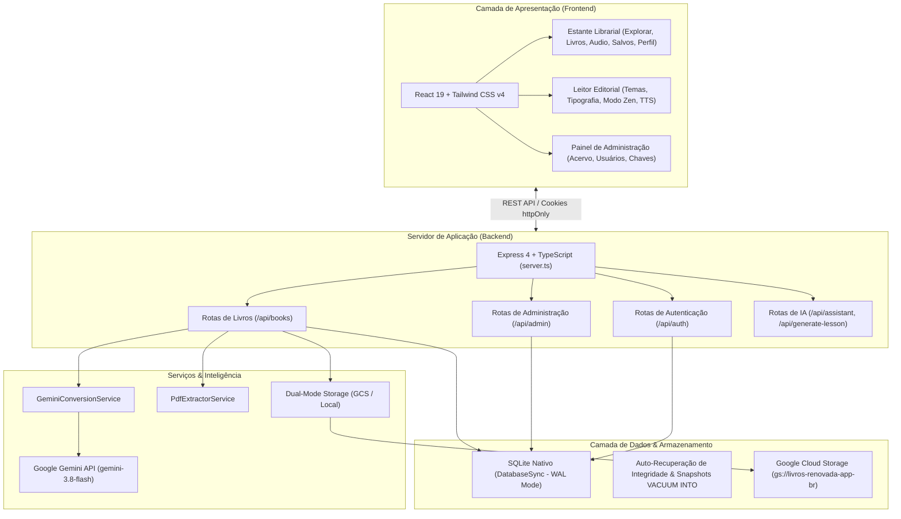
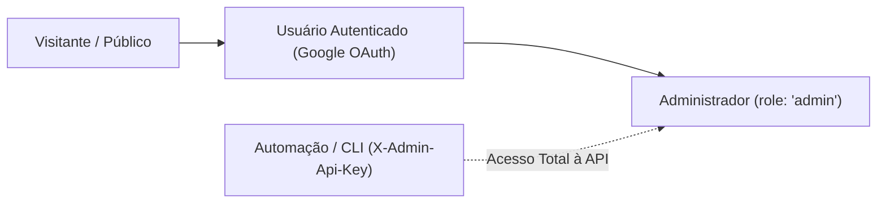

# Documentação da Plataforma Lumi: Menus, Acessos, Arquitetura e Funcionalidades

> **Projeto**: Lumi — Biblioteca Digital & Leitor Editorial (`lumi-renovada-app-br`)  
> **Módulo**: Plataforma Web, Painel Administrativo, Segurança e Funcionalidades do Sistema  
> **Status**: Produção / Ativo  

---

## 1. Visão Geral da Solução

O **Lumi** é uma aplicação web moderna voltada para a gestão de acervo literário, leitura editorial de alto conforto, capacitação de liderança e estudo bíblico e teológico.

### Arquitetura Geral da Aplicação



---

## 2. Níveis de Acesso, Autenticação e Governança (RBAC)

O sistema conta com um modelo seguro de controle de acesso baseado em papéis (*Role-Based Access Control* - RBAC):



### 2.1. Matriz de Permissões

| Funcionalidade / Recurso | Visitante (Público) | Usuário Logado (`user`) | Administrador (`admin`) | Chave API (`X-Admin-Api-Key`) |
| :--- | :---: | :---: | :---: | :---: |
| **Navegação no Catálogo e Categorias** | Sim | Sim | Sim | Sim |
| **Leitura Completa no Leitor Editorial** | Sim | Sim | Sim | Sim |
| **Uso do Audiobook Player (TTS)** | Sim | Sim | Sim | Não aplicável |
| **Busca Instantânea (`Ctrl+K`)** | Sim | Sim | Sim | Não aplicável |
| **Avaliação de Livros (1 a 5 estrelas)** | Sim (Anônimo) | Sim (Vinculado à conta) | Sim | Não |
| **Download de HTML Offline e PDF** | Sim | Sim | Sim | Não aplicável |
| **Histórico de Leitura no Dispositivo** | Sim (`localStorage`) | Sim | Sim | Não aplicável |
| **Sincronização do Progresso em Nuvem** | Não | Sim | Sim | Não aplicável |
| **Upload de Novos Livros em PDF** | Não | Sim | Sim | Sim |
| **Edição de Metadados e Capítulos** | Não | Sim | Sim | Sim |
| **Reprocessamento de Conversões** | Não | Sim | Sim | Sim |
| **Acesso ao Painel Admin (`/admin`)** | Não | Não | Sim | Sim |
| **Gestão e Bloqueio de Usuários** | Não | Não | Sim | Sim |
| **Configuração de Chave Gemini AI** | Não | Não | Sim | Sim |
| **Geração de Chave de Automação** | Não | Não | Sim | Sim |
| **Exclusão Definitiva de Livros** | Não | Não | Sim | Sim |
| **Destaque Editorial (`is_featured`)** | Não | Não | Sim | Sim |

---

### 2.2. Fluxo de Autenticação Google OAuth2

1. **Frontend**: Carrega o Google Identity Services (`https://accounts.google.com/gsi/client`).
2. O usuário faz login com sua conta Google e recebe uma credencial segura (ID Token JWT assinado).
3. **Backend (`POST /api/auth/google`)**:
   - Valida a assinatura criptográfica do ID Token com o `OAuth2Client` do Google.
   - Realiza o *upsert* do usuário na tabela `users` (registrando id, e-mail, nome e foto de perfil).
   - Valida se o usuário não está com a flag `is_blocked = 1`.
   - Gera um `session_token` criptografado de 32 bytes e armazena na tabela `sessions`.
   - Emite um cookie seguro `httpOnly`:
     - `httpOnly: true` (protegido contra ataques XSS).
     - `secure: true` em ambiente de produção (HTTPS).
     - `sameSite: 'lax'` (protegido contra ataques CSRF).
     - Duração de 30 dias (`maxAge: 30 * 24 * 60 * 60 * 1000`).
4. **Administrador Inicial Semeado**:
   - Durante a inicialização do banco, o e-mail `cardoso.oliveira@gmail.com` é automaticamente inserido e garantido com o papel `role = 'admin'` (`Requirement 4`).

---

## 3. Catálogo de Telas, Menus e Componentes

### 3.1. Estante Digital & Navegação Librarial (`LibraryScreen.tsx`)

A Estante Digital é a porta de entrada da aplicação, oferecendo uma experiência visual comparável a serviços de streaming literário:

#### A. Barra de Navegação Inferior / Abas Principais (`BottomNavigation`)
- **Explorar (`browse`)**:
  - Exibe o Carrossel de Destaques Editoriais (`FeaturedCarousel`), com os títulos selecionados pela curadoria pastoral.
  - Trilha horizontal de Livros Populares (`PopularBooksScroll`), ordenados pela média de avaliação e número de leitores.
  - Grade com todo o catálogo disponível.
- **Livros (`books`)**:
  - Catálogo completo focado na exploração de obras, permitindo alternar entre modo Grade (*Grid*) e Lista Detalhada (*List*).
- **Audiobooks (`audiobooks`)**:
  - Filtro direto que destaca os livros disponíveis para escuta através do player Text-to-Speech.
- **Salvos (`bookmarks`)**:
  - Lista de livros favoritos salvos localmente pelo leitor com um clique no ícone de coração.
- **Perfil (`profile`)**:
  - Informações do usuário logado (foto, nome, e-mail).
  - Resumo de leitura (quantidade de livros iniciados e concluídos).
  - Botão de acesso ao Painel de Administração (apenas visível para administradores).
  - Botão de Logout.

#### B. Barra de Filtros e Busca (`FloatingFilterBar` & `CategoryPills`)
- **Busca em Tempo Real**: Filtra instantaneamente por título da obra, subtítulo, autor ou termos da sinopse.
- **Pílulas de Categoria**: Filtros rápidos por grandes temas:
  - *Todos*, *Liderança*, *Células*, *Discipulado*, *Teologia*, *Biografias*, *Vida Cristã*.
- **Ordenação**: Menu suspenso para ordenar por:
  - *Mais Populares*, *Melhor Avaliados*, *Mais Recentes*, *Título (A-Z)* ou *Autor (A-Z)*.

#### C. Card de Livro (`BookCard.tsx`)
- Apresenta a capa do livro com efeito de elevação tridimensional.
- Badge dinâmico de status de conversão:
  - *Verde*: Livro pronto para leitura.
  - *Âmbar com spinner*: Livro em processamento (mostrando a etapa atual).
  - *Vermelho*: Erro de processamento.
- Selo de progresso de leitura (ex.: "8 de 12 capítulos concluídos" com barra percentual).
- Classificação por estrelas (1 a 5) e quantidade de avaliações.
- Botão de favoritar rápido.

#### D. Modal de Detalhes da Obra (`BookDetailModal.tsx`)
Abre ao clicar em qualquer livro do catálogo:
- Sinopse completa e ficha catalográfica (autor, ano, editora, total de capítulos e tempo estimado).
- Sistema interativo de avaliação por estrelas (1 a 5 estrelas) com cálculo dinâmico da média da comunidade.
- Lista completa dos capítulos do livro.
- **Ações de Leitura**:
  - **"Ler Agora"**: Abre o livro na página do capítulo onde o leitor parou.
  - **"Ouvir Audiobook"**: Inicia o player de áudio a partir do capítulo 1.
  - **"HTML Offline"**: Baixa o livro em arquivo único `.html` para abrir sem internet.
  - **"PDF Original"**: Abre o arquivo PDF original em visualizador embutido.
- **Ações de Gestão (para usuários logados)**:
  - Botão **"Editar Livro"**: Abre o `BookEditorModal`.
  - Botão **"Reprocessar com IA"**: Reinicia a conversão inteligente.
  - Botão **"Excluir"**: Remove o livro da biblioteca (restrito a administradores).

---

### 3.2. Leitor Editorial Avançado (`ChapterReader.tsx`)

Ambiente imersivo de leitura, desenhado com foco absoluto em ergonomia visual e ausência de distrações:

#### A. Barra Superior do Leitor (`Navbar.tsx`)
- Botão retrátil para abrir a Gaveta de Capítulos (`Sidebar`).
- Botão de retorno à Estante Virtual.
- **Seletor de Temas Visuais**:
  - **Sépia / Pergaminho**: Fundo suave `#f7f3e8` com tipografia café `#2c2217`, ideal para leitura contínua durante o dia.
  - **Escuro (Dark)**: Fundo preto `#0f141c` de alto contraste, ideal para ambientes noturnos.
  - **Claro**: Fundo branco neutro com tipografia cinza chumbo `#1e293b`.
- **Controle Tipográfico**:
  - Alternância de Família de Fonte: Serifada clássica (`Georgia`) ou Sem Serifa moderna (`Inter`).
  - Tamanho de Fonte: `sm` (pequeno), `base` (padrão), `lg` (grande), `xl` (extra grande).
  - Espaçamento entre Linhas (*Line Height*): `normal` (1.5), `relaxed` (1.75), `loose` (2.0).
- **Modo Foco Zen (Zen Focus Mode)**:
  - Ativado pelo ícone de tela cheia ou pela tecla **`F`**.
  - Oculta todos os cabeçalhos, barras laterais e rodapés, deixando unicamente a mancha de texto do livro na tela. Pressione **`Esc`** para sair.
- **Busca Global no Livro (`Ctrl+K`)**:
  - Abre o `SearchModal`, indexando todo o conteúdo do livro ativo em memória com navegação imediata para o termo encontrado.

#### B. Player de Audiobook Integrado (`AudiobookPlayer.tsx`)
- Narração em áudio Text-to-Speech nativa em Português (`pt-BR`) via Web SpeechSynthesis.
- **Sincronização Visual de Leitura**: O parágrafo que está sendo narrado no momento recebe um destaque cromático suave com borda lateral na cor do tema, permitindo ao leitor acompanhar visualmente a audição.
- Controles: Play, Pause, Reiniciar, Voltar Parágrafo, Avançar Parágrafo, Silenciar e Seletor de Velocidade (`1x`, `1.25x`, `1.5x`, `2x`).

#### C. Gaveta Lateral de Capítulos (`Sidebar.tsx`)
- Lista vertical de todos os capítulos com numeração, títulos e indicação de páginas originais.
- Checkbox para marcar o capítulo como concluído.
- Botão **"Baixar Livro Diagramado (.pdf)"**: Gera um PDF diagramado em tempo real via biblioteca `jsPDF`.
- Botão **"Baixar Arquivo Único HTML (.html)"**: Exporta todo o livro como aplicativo offline em arquivo único.
- Botão **"Ver PDF Original"**: Abre o modal com o arquivo PDF original.

#### D. Recursos Pedagógicos e de IA no Capítulo
Ao final de cada capítulo, o leitor encontra:
- **Perguntas para Reflexão e Liderança**: Questões práticas geradas durante a conversão editorial.
- **Mentor de Estudo IA (`POST /api/assistant`)**: Campo interativo para enviar dúvidas teológicas ou práticas sobre o capítulo atual para o assistente `gemini-3.8-flash`.
- **Gerador de Roteiro de Célula de 90 Minutos (`POST /api/generate-lesson`)**: Cria um plano de reunião pronto com quebra-gelo, louvor, estudo bíblico em perguntas cruzadas, alvos de oração e comunhão.

---

### 3.3. Painel de Administração (`AdminScreen.tsx`)

Área restrita a usuários com perfil de Administrador (`role: 'admin'`), organizada em três grandes módulos:

#### A. Aba "Acervo & Biblioteca"
- Tabela paginada com visualização de todos os livros do banco de dados.
- Filtro por status de conversão: *Todos, Prontos (ready), Convertendo (processing), Erro (error)*.
- Busca por título do livro ou nome do autor.
- Coluna **"Destaque Editorial"**: Alternador com estrela para promover o livro ao carrossel de destaques da página inicial (`PUT /api/admin/books/:id/featured`).
- Ações por livro:
  - *Editar*: Abre o `BookEditorModal`.
  - *Reprocessar*: Reinicia a conversão inteligente com IA (`POST /api/admin/reprocess/:id`).
  - *PDF Original*: Abre o arquivo PDF do storage.
  - *Excluir*: Remove o livro do banco e do storage (o livro padrão "A Igreja em Células" possui trava de segurança contra exclusão acidental).

#### B. Aba "Gestão de Usuários"
- Lista completa de todos os usuários que já realizaram login com o Google.
- Exibe avatar, nome, e-mail, papel atual e data de cadastro.
- **Ações**:
  - **Alterar Papel (`PUT /api/admin/users/:id/role`)**: Promover usuário a `admin` ou rebaixar a `user` (com salvaguarda que impede que o próprio administrador logado remova seu privilégio de admin).
  - **Bloquear / Desbloquear (`PUT /api/admin/users/:id/block`)**: Suspende temporariamente o acesso do usuário à plataforma.

#### C. Aba "Chaves de API & Automação"
- **Google Gemini API Key (`GET` / `POST /api/admin/api-key`)**:
  - Exibe o status da chave configurada no servidor com máscara de segurança (ex.: `AIza••••••••1234`).
  - Permite aos administradores cadastrar ou alterar a chave Gemini sem necessidade de reiniciar o container ou editar o `.env`.
- **Chave de API de Administração (`X-Admin-Api-Key`)**:
  - Exibe o status e o valor da chave mestra utilizada em integrações externas e scripts de importação em lote (`scripts/import-calibre-books.ts`).
  - Permite gerar uma nova chave mestra criptográfica (`lumi_...`) com 1 clique e copiá-la para a área de transferência.

#### D. Métricas Gerais do Sistema (`GET /api/admin/stats`)
- Painel com cartões com contagem de:
  - Total de Livros Cadastrados.
  - Total de Leitores / Usuários Registrados.
  - Total de Administradores.
  - Status da Chave Gemini (Ativa / Inativa).
  - Quantidade de livros por status (`ready`, `processing`, `error`).

---

### 3.4. Modais Operacionais

1. **Upload de Livro (`UploadBookModal.tsx`)**:
   - Área de arrastar e soltar (*drag & drop*) para arquivos PDF de até 60 MB.
   - **Botão "Preencher com IA / Metadados Automáticos"**:
     - Analisa as páginas 1 a 6 do PDF antes do envio final.
     - Extrai Título, Subtítulo, Autor, Ano de Publicação, Editora, Categoria e Sinopse.
   - Seletor de cor da capa editorial (Âmbar, Esmeralda, Azul Real, Rubi, Violeta).
   - Campo para instruções personalizadas de conversão (ex.: *"Traduza do espanhol para o português mantendo os termos bíblicos da versão Almeida Atualizada"*).
   - Barra de progresso percentual e feedback textual das etapas em tempo real.

2. **Editor de Capítulos e Metadados (`BookEditorModal.tsx`)**:
   - Permite corrigir títulos, subtítulos, nomes de autor e notas de tradução.
   - **Seletor de Página da Capa**: Permite informar em qual página do PDF está a imagem de capa correta e clica em "Atualizar Capa" para re-renderizar o PNG na hora.
   - Gestão de Capítulos: Adicionar novo capítulo, remover capítulo, reordenar capítulos e editar os parágrafos de texto diretamente.

3. **Visualizador de PDF Original (`PdfViewerModal.tsx`)**:
   - Modal responsivo que carrega o PDF original transmitido via streaming da rota `GET /api/books/:id/pdf`.

4. **Busca Global no Livro Ativo (`SearchModal.tsx`)**:
   - Acionado pelo atalho universal `Ctrl+K` ou `Cmd+K`.
   - Permite localizar qualquer palavra ou trecho no livro atual com realce amarelo (*highlight*) e salto instantâneo para o parágrafo.

---

## 4. Persistência de Dados e Armazenamento Resiliente

### 4.1. Banco de Dados SQLite (`src/server/db/database.ts`)

A persistência de dados utiliza a biblioteca nativa `node:sqlite` (`DatabaseSync` do Node.js v22+), garantindo altíssimo desempenho e zero dependências de compilação em C++ nativo:

- **Configurações de Alta Concorrência (PRAGMAs)**:
  - `PRAGMA journal_mode = WAL`: Garante que leituras simultâneas não bloqueiem escritas.
  - `PRAGMA synchronous = NORMAL`: Balanço ideal entre integridade física e velocidade de gravação em disco.
  - `PRAGMA busy_timeout = 5000`: Aguarda até 5 segundos para liberar travas de transação antes de emitir erro de concorrência.
- **Mecanismo de Auto-Recuperação de Corrupção (`recoverCorruptedDatabaseFile`)**:
  - Na inicialização, executa `PRAGMA integrity_check`.
  - Se for detectada qualquer corrupção de imagem de disco decorrente de desligamento abrupto de containers, o sistema executa automaticamente a ferramenta de reparo CLI `sqlite3 .recover` / `.dump`, gerando um novo arquivo de banco íntegro e salvando backup do corrompido.
- **Snapshots Atômicos (`createDatabaseSnapshot`)**:
  - Utiliza o comando `VACUUM INTO 'caminho_snapshot'` para gerar cópias de backup consistentes em tempo real sem interrupção de leitura ou escrita.

---

### 4.2. Estratégia de Armazenamento Dual-Mode (`storageService.ts`)

O armazenamento de capas recortadas (`covers/`) e arquivos PDF brutos (`pdfs/`) adapta-se dinamicamente ao ambiente de execução:
- **Ambiente de Nuvem (Google Cloud Run)**: Conecta-se ao bucket Google Cloud Storage `gs://livros-renovada-app-br` usando a conta de serviço padrão do projeto GCP `renovada-app-br`.
- **Ambiente Local / Desenvolvimento**: Se não houver credenciais de nuvem disponíveis, grava e recupera arquivos transparentemente na pasta local `storage/`.

---

## 5. Especificação de Rotas e Endpoints da API

### Módulo de Livros (`/api/books`)
- `GET /api/books`: Retorna lista resumida de todos os livros e disponibilidade da chave Gemini.
- `GET /api/books/:id`: Retorna livro completo com todos os capítulos, parágrafos e metadados.
- `POST /api/books/extract-metadata`: Analisa PDF e extrai metadados antes do upload.
- `POST /api/books/upload`: Envia novo PDF e inicia a conversão em segundo plano.
- `POST /api/books/:id/reprocess`: Reinicia conversão inteligente de um livro existente.
- `PUT /api/books/:id`: Atualiza metadados ou capítulos de um livro existente.
- `DELETE /api/books/:id`: Exclui livro da biblioteca (requer permissão de Admin).
- `GET /api/books/:id/cover`: Serve a imagem da capa em formato PNG com cache de 1 hora.
- `POST /api/books/:id/cover-page`: Define outra página do PDF como imagem de capa.
- `GET /api/books/:id/pdf`: Transmite o arquivo PDF original em streaming com cabeçalho `inline`.
- `POST /api/books/:id/rate`: Registra avaliação por estrelas (1 a 5) do leitor.
- `GET /api/books/:id/user-rating`: Retorna a nota atribuída pelo usuário atual.

### Módulo de Administração (`/api/admin`)
- `GET /api/admin/stats`: Retorna contadores e estatísticas gerais.
- `GET /api/admin/users`: Lista todos os usuários cadastrados.
- `PUT /api/admin/users/:id/role`: Altera o papel de um usuário (`admin` ou `user`).
- `PUT /api/admin/users/:id/block`: Bloqueia ou desbloqueia uma conta de usuário.
- `GET /api/admin/api-key`: Retorna o status e chave mascarada do Gemini.
- `POST /api/admin/api-key`: Atualiza a chave Gemini do servidor.
- `GET /api/admin/admin-key`: Retorna a chave de automação mestra.
- `POST /api/admin/admin-key`: Gera ou altera a chave de automação mestra.
- `PUT /api/admin/books/:id/featured`: Alterna o status de destaque editorial de uma obra.

### Módulo de Autenticação (`/api/auth`)
- `GET /api/auth/config`: Fornece o Client ID público do Google OAuth.
- `POST /api/auth/google`: Valida o token JWT do Google e emite o cookie de sessão `session_token`.
- `GET /api/auth/me`: Retorna os dados do usuário autenticado e seus capítulos lidos.
- `POST /api/auth/logout`: Revoga a sessão ativa e exclui os cookies do cliente.
- `GET /api/auth/progress`: Consulta o histórico de leitura do usuário.
- `POST /api/auth/progress`: Sincroniza os capítulos lidos e última posição de leitura do usuário.

### Módulo de Assistência Pastoral com IA (`/api`)
- `POST /api/assistant`: Envia pergunta do leitor com o contexto do capítulo para o mentor IA.
- `POST /api/generate-lesson`: Gera roteiro completo de 90 minutos para estudo em células.

---

## 6. Procedimentos de Operação e Deploy

### 6.1. Execução Local
```bash
# 1. Instalar dependências
npm install

# 2. Iniciar servidor de desenvolvimento (Frontend + Backend unificados)
npm run dev
# Acesse em http://localhost:3000
```

### 6.2. Deploy em Produção (Google Cloud Run)
O projeto conta com `Dockerfile` multi-stage com compilação de assets estáticos e servidor TypeScript em container leve:
```bash
gcloud run deploy livros-renovada-app-br \
  --source . \
  --project=renovada-app-br \
  --region=us-central1 \
  --allow-unauthenticated \
  --set-env-vars="NODE_ENV=production,GCP_PROJECT_ID=renovada-app-br,GCS_BUCKET=livros-renovada-app-br"
```
